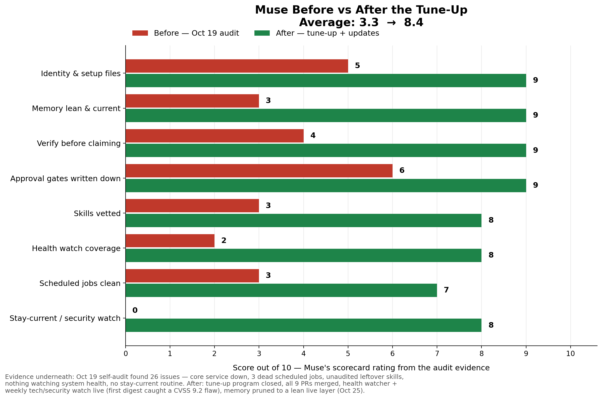

# Before vs After — what a tune-up actually changed

One real Muse's scorecard, from its owner's setup. The "before" is a
self-audit run on Oct 19; the "after" is the state once the tune-up
program closed (Oct 21) plus the follow-on updates (memory prune,
Oct 25). Scores are that Muse's own rating out of 10 from the audit
evidence — a summary, not a lab measurement. The hard counts under
the chart are the evidence the ratings rest on.

| Area | Before | After |
|---|---|---|
| Identity & setup files | 5 | 9 |
| Memory lean & current | 3 | 9 |
| Verify before claiming | 4 | 9 |
| Approval gates written down | 6 | 9 |
| Skills vetted | 3 | 8 |
| Health watch coverage | 2 | 8 |
| Scheduled jobs clean | 3 | 7 |
| Stay-current / security watch | 0 | 8 |
| **Average** | **3.3** | **8.4** |

## The evidence

**Before (Oct 19 self-audit):**
- 26 numbered findings: broken-now items, missing access, unfinished
  setups, and daily friction — each with evidence and a proposed fix.
- A core background service was silently down; nothing was watching
  it, or the rest of the system's health.
- 3 dead scheduled jobs still on the books, plus one still running
  after its job had already resolved.
- 23 custom skills installed, including unaudited leftovers nobody
  remembered adding.
- No stay-current routine at all: new tools, model updates, and
  security issues in the Muse's own stack arrived by accident.

**After (tune-up closed Oct 21, updates through Oct 25):**
- Tune-up program closed out: all 9 pull requests merged, every audit
  item carried to a verdict.
- A health watcher now checks the system's own services and jobs,
  with a first-run grace so it doesn't cry wolf.
- A weekly tech & security watch scans the Muse's own stack for
  releases and vulnerabilities, one verdict per item
  (WORTH IT / SKIP / SECURITY FLAG). Its first digest caught a
  CVSS 9.2 flaw in a bundled library.
- Memory pruned to a lean live layer — current state and standing
  rules only, history archived to dated notes.
- Skill scanning adopted as the standing rule before anything new
  gets installed.

That's the gap this kit is meant to close on a new Muse: not new
features — an audit, written-down gates, watchers that notice when
something's down, and memory that stays lean enough to be useful.
